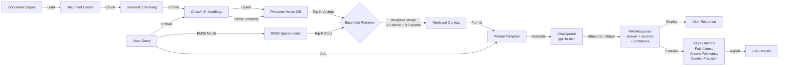

# Checkpoint RAG: Production-Grade Retrieval-Augmented Generation system

## Overview

Checkpoint RAG is a Retrieval-Augmented Generation (RAG) system for answering internal employee questions using a curated knowledge base of product documentation, runbooks, and support tickets. It combines hybrid search (dense vector retrieval + sparse BM25 retrieval), grounded prompting, and evaluation tooling to deliver answers with source traceability and confidence indicators.

The system ingests Markdown, PDF, and HTML content, chunks it into semantically focused sections, embeds those sections, and stores them in Pinecone. Retrieval is handled by a hybrid ensemble retriever. Generation is performed by a grounded chat model that returns a structured `RAGResponse` containing the answer, sources, and confidence.

---

## Loom walkthrough

### Module 1

- https://www.loom.com/share/0f17ef142a2543549245af15d1a501d9
- https://www.loom.com/share/5d51755c783f45ed80e9495a6c54f3ac
- https://www.loom.com/share/3a8fcbc3fbb1443c80ea93be42be8118
- https://www.loom.com/share/0a15e6a8289942869194f893b2d434ae
- https://www.loom.com/share/c680794a057642f09ba5399e4c4dc127

### Module 4

TBD

---

## Architecture



---

## Chunking strategy

### Chunk size: 100 tokens (~400 characters)

Why:

- Smaller chunks improve retrieval precision by reducing noise.
- Each chunk stays focused on a single concept.
- 100 tokens is large enough to preserve context while remaining specific.

### Overlap: 20% (20 tokens)

Why:

- Preserves continuity across chunk boundaries.
- Avoids losing information at the end of one section and the start of the next.
- A 20% overlap is a practical tradeoff between relevance and cost.

### Document-type-specific strategies

| Document type | Strategy | Separators | Special handling |
| --- | --- | --- | --- |
| Markdown | Header-aware + recursive split | Headers (`#`, `##`, `###`) → paragraphs (`\n\n`) → sentences (`. `) → words | Preserves semantic section boundaries |
| PDF | Recursive character split | Paragraphs (`\n\n`) → lines (`\n`) → sentences (`. `) → words | Handles both text-native and OCR-derived PDFs |
| HTML | HTML-aware recursive split | Block elements (`</p>`, `</div>`) → paragraphs (`\n\n`) → sentences (`. `) | Strips HTML tags and preserves logical boundaries |

### Why different strategies?

- Markdown documents have an explicit hierarchy of headings and sections.
- PDFs are structurally weaker and rely more on paragraph and sentence boundaries.
- HTML often exposes semantic block boundaries better than raw whitespace.

Result: roughly 600-800 total chunks across 50 documents, with better precision for single-concept retrieval. Smaller chunks result in more vectors and stronger semantic targeting.

---

## Retrieval strategy: hybrid search (dense + sparse)

### Implementation

```python
retriever = EnsembleRetriever(
    retrievers=[
        pinecone_retriever,  # Dense semantic similarity
        bm25_retriever,      # Sparse keyword matching
    ],
    weights=[0.5, 0.5],
)
```

### Why hybrid search?

#### Dense retrieval alone

Pros:

- Captures semantic meaning beyond exact keywords.

Cons:

- Struggles with terminology mismatches.
- Can miss exact matches such as `HTTP 429` when the phrasing differs from the source text.

#### Sparse retrieval alone

Pros:

- Strong at exact keyword and acronym matching.

Cons:

- Weak when the query is conceptual or rephrased.

#### Hybrid retrieval (0.5 dense + 0.5 sparse)

Pros:

- Balances semantic relevance with exact keyword coverage.
- More robust against paraphrasing and jargon-heavy queries.

Cons:

- Adds a small amount of latency.

### Measured impact

Before: vector-only retrieval

- Context precision: 0.8794
- Answer relevancy: 0.8421
- Average latency: 1.5s/query

After: hybrid retrieval (0.5/0.5)

- Context precision: 0.9344
- Answer relevancy: 0.8718
- Average latency: 2.0s/query

---

## Generation prompt and structured output

### System prompt

```text
You are an internal AI Support Assistant for the Customer Success team. Your primary task
is to answer employee queries accurately using ONLY the provided internal documentation,
runbooks, and post-mortems.

Instructions:
1. Grounding: Base your answer strictly on the facts present in the context.
   Do NOT extrapolate or bring in outside knowledge.
2. Sources: List the document IDs of the sources used to formulate the answer.
3. Unanswered Queries: If the context lacks sufficient information, explicitly state
   that you cannot answer from the knowledge base and set confidence to 'low'.

### Internal Context:
{context}
```

### Prompt template structure

```python
prompt = ChatPromptTemplate.from_messages([
    ("system", SYSTEM_PROMPT),
    ("human", "CSM Query: {query}"),
])
```

### Reasoning behind the structure

1. System message with a role definition
   - Anchors the model to a specific persona.
   - Prevents hallucinations by explicitly forbidding unsupported extrapolation.
   - Emphasizes grounding in the provided context.

2. Structured output using a Pydantic schema

   ```python
   class RAGResponse(BaseModel):
       answer: str
       sources: list[str]
       confidence: Literal["low", "medium", "high"]
   ```

   This makes downstream automation easier and keeps outputs machine-friendly.

3. Context formatting with document IDs

   ```python
   "--- Document ID: {doc_id} ---\nContent:\n{chunk_text}\n"
   ```

   Inline citations make it easier for the model to reference reliable evidence.

4. Temperature = 0
   - Keeps generation deterministic.
   - Matters for internal support workflows where consistency is critical.

---

## Evaluation results

### Summary metrics (50-query test set)

| Metric | Score |
| --- | ---: |
| Faithfulness | 93.32% |
| Answer relevancy | 84.21% |
| Context precision | 87.94% |

Interpretation:

- Faithfulness is high, meaning answers are strongly supported by retrieved context.
- Answer relevancy is good but not perfect for more complex troubleshooting questions.
- Context precision shows that retrieval still occasionally brings in unrelated evidence.

### Query-level breakdown

| Category | Easy | Medium | Hard | Avg precision |
| --- | ---: | ---: | ---: | ---: |
| Workflows | 5 | 3 | 2 | 92% |
| API | 8 | 2 | 1 | 89% |
| Billing | 3 | 2 | 0 | 91% |
| Admin | 4 | 3 | 1 | 85% |
| Troubleshooting | 2 | 4 | 5 | 76% |

Key insight: easy queries perform well, while troubleshooting and multi-hop queries have lower precision and greater risk of incomplete answers.

### Representative failure cases

#### Case 1: Q020 — SLA mismatch (precision = 0.0)

- Query: "What's the support response SLA on Pro?"
- Ground truth: "On Pro, the support response SLA is 8 hours."
- Generated answer: the model pulled a mismatched SLA rule from a different document.
- Root cause: a terminology mismatch between the query and the source documentation.
- Fix: use hybrid search, which includes sparse keyword matching.

#### Case 2: Q042 — complex reasoning (answer relevancy = 0.0)

- Query: "I'm seeing my workflow run time slowly creep up over the last two weeks even though I haven't changed anything. What should I look at?"
- Root cause: the problem required multi-step diagnostics spread across multiple sources.
- Fix: implement multi-query expansion or a stronger reasoning flow.

#### Case 3: Q017 — provider vs. platform context (precision = 0.0)

- Query: "What does HTTP 401 mean from the Helix API?"
- Root cause: the model confused API-authentication context with OAuth or provider context.
- Fix: add metadata filters or a reranking step for context-aware retrieval.

---

## How to run

```bash
# 1. Clone repository and navigate to the project root
git clone https://github.com/Amogha03/checkpoint-rag.git
cd checkpoint-rag

# 2. Create a virtual environment and install dependencies
python3 -m venv .venv
source .venv/bin/activate
pip install -e .

# 3. Create the environment configuration file and add your API keys
cp .env.example .env

# 4. Ingest the document corpus into Pinecone
python -m src.ingest --corpus ./corpus

# 5. Run a test query and execute the evaluation harness
python src/pipeline.py
python -m evals.harness
```

---

## Next steps: ranked improvements for next week

### 1. Multi-query expansion (high priority, medium effort)

- Problem: complex queries and terminology mismatches reduce retrieval quality.
- Solution: expand a single query into multiple reformulations and retrieve from all of them.
- Expected impact: improved answer relevancy for troubleshooting queries.

### 2. Re-ranking with a cross-encoder (high priority, high effort)

- Problem: hybrid search still allows semantically related but contextually wrong documents to rank too high.
- Solution: re-rank top results after retrieval.
- Expected impact: better context precision and fewer false positives.

### 3. Caching and query deduplication (medium priority, low effort)

- Problem: repeated customer support questions recompute retrieval unnecessarily.
- Solution: cache repeated query results for a short TTL.
- Expected impact: lower latency for common requests.

### 4. Incremental ingestion and update pipeline (low priority, high effort)

- Problem: re-ingesting the full corpus is inefficient for small updates.
- Solution: track document hashes and only reprocess modified content.
- Expected impact: much faster refreshes for content updates.

---

## Project structure

```text
checkpoint-rag/
├── src/
│   ├── ingest.py              # Document loading, chunking, embedding, Pinecone upsert
│   ├── retrieve.py            # Hybrid retrieval (Pinecone + BM25)
│   ├── generate.py            # LLM prompt + structured output
│   └── pipeline.py            # Retrieve -> generate orchestration
├── evals/
│   ├── harness.py             # Ragas evaluation engine
│   ├── test_set.json          # 50-query ground truth dataset
│   └── results/
│       ├── eval_results.json  # Machine-readable eval results
│       └── eval_report.md     # Human-readable evaluation report
├── ops/
│   ├── data_quality/
│   ├── langsmith/
│   ├── monitoring/
│   └── phoenix/
├── corpus/
│   ├── README.md
│   ├── product-docs/
│   ├── runbooks/
│   └── tickets/
├── tests/
│   ├── test_ingest.py
│   ├── test_retrieve.py
│   ├── test_generate.py
│   └── test_evals.py
├── pyproject.toml
├── README.md
└── .env.example
```

---

## Dependencies

- LangChain: orchestration and retrieval tooling
- OpenAI: GPT-4o-mini for generation and text-embedding-3-small for embeddings
- Pinecone: vector database
- Ragas: evaluation metrics
- Pydantic: structured output schemas

---

## Operational maturity summary

The system adds repeatable LangSmith evaluations, optional Phoenix/OpenTelemetry tracing, Great Expectations checks on chunks and vectors, and an operations monitoring specification with release gates and incident guidance.

The controls connect end-to-end:

- validate data before it can change Pinecone
- trace requests to inspect latency, token usage, and retrieved sources
- evaluate answer quality against a versioned reference set
- decide whether to release or investigate based on those results

---

## Eval methodology

The local Ragas harness reports:

- faithfulness: whether answer claims are supported by the retrieved context
- answer relevancy: whether the answer matches the user's query
- context precision: whether retrieval returned relevant evidence

The LangSmith run uses corresponding faithfulness and relevance evaluators plus a custom `csm_support_accuracy` LLM-as-a-judge. This judge receives the query, generated answer, retrieved contexts, reference answer, and expected/returned sources, then scores accuracy and completeness from 0 to 1 with a rationale.

The reference answer and expected-source fields anchor the judge to the evaluation set rather than general model knowledge. This is reference-based rubric grounding, not a formal statistical calibration. Treat the judge as a release signal to review, not as absolute ground truth.

LangSmith project: [Checkpoint RAG Ops Evals](https://smith.langchain.com/o/8e1877a0-b0a4-4ce4-9417-1b5030c0a3c7/a/checkpoint-rag-ops-evals/projects/p/09665629-c9f5-4e32-b0da-2d07b7100efe)

---

## Observability findings

Phoenix instruments LangChain and adds query-level spans with latency, token counts, retrieved document IDs, and answer citations. In the saved sample, mean latency was 1.468s and maximum latency was 2.512s.

The main findings were:

- expected sources were not always prioritized
- some duplicate sources were returned
- irrelevant context still consumed prompt space and could distract generation

The repository currently tracks these as a baseline rather than claiming a measured improvement without a post-fix evaluation.

---

## Data quality contract

Before ingestion can recreate the Pinecone index or upsert vectors, Great Expectations checks must pass:

- approximate chunk size is between 50 and 300 tokens
- `source_path`, `chunk_index`, `doc_type`, and `chunk_text` are non-null
- `chunk_index` is nonnegative
- an embedding exists and has exactly 1536 dimensions
- `contains_pii` is false

Any failed expectation rejects the batch before Pinecone mutation.

---

## Monitoring plan summary

| Signal | Threshold | Rationale |
| --- | --- | --- |
| End-to-end latency | Warn at p95 > 5s for 10 min; page at p95 > 10s for 5 min | Detect sustained tail latency before it becomes user-visible |
| Availability / error rate | Availability >= 99.5% monthly; error rate < 1% over 5 min | catch recurring failures early |
| Answer quality | Faithfulness and support accuracy >= 0.90; relevance >= 0.85 | release gate for quality and completeness |
| Source / citation quality | Expected-source hit rate >= 0.90 | answers need trustworthy, relevant evidence |
| Ingestion quality | 100% of Great Expectations checks pass before Pinecone mutation | prevents invalid content from entering the index |

---

## Production readiness verdict

**HOLD for general production rollout.**

Three evidence points support this decision:

1. The saved 50-query evaluation reports mean CSM support accuracy below the release threshold, despite high faithfulness and relevance.
2. Phoenix surfaced retrieval noise and duplicate-source behavior.
3. The data-quality sample passed checks, but the sample is not a full-corpus audit and production load, rollback, and alert handling have not been demonstrated.

I would move to a limited GO only after the fixed evaluation set meets the quality thresholds, low-scoring cases receive human review, retrieval changes improve source quality without unacceptable latency regressions, and load testing establishes production baselines with tested alerts.

---

## License and support

Built as an internal tool for Customer Success. For questions or improvements, contact the Data/AI team.
